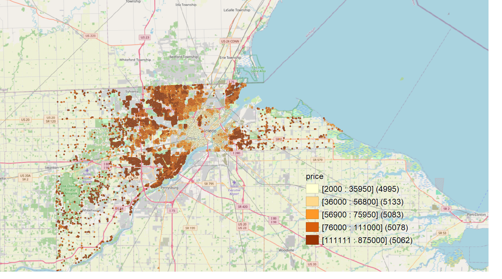
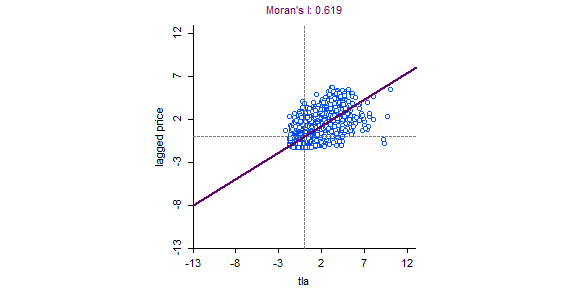
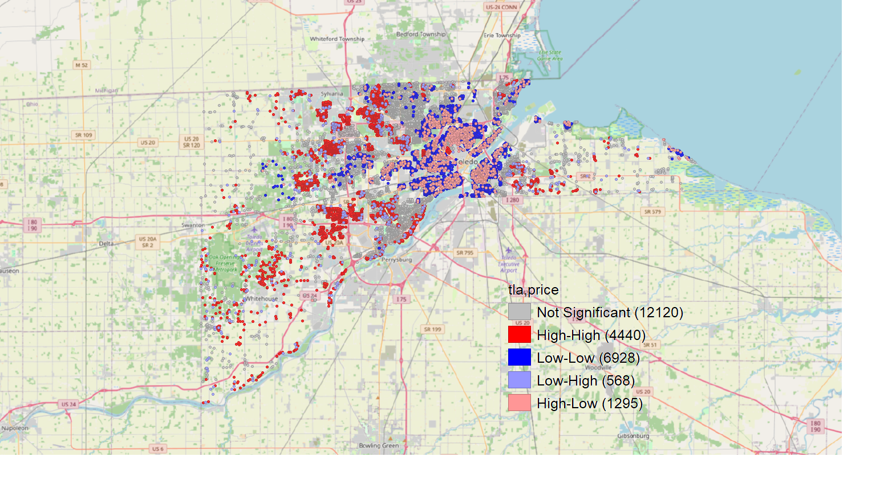

```{r}
#| label: setup
#| message: false
library(tidyverse)
library(lubridate)
library(sf)
library(here)
library(tmap)
library(sp)
library(spdep)
library(spatialreg)
library(lmtest)
library(sandwich)
library(units)
library(car)
library(foreign)
library(tigris)
library(tidycensus)
library(gt)
library(flextable)
library(modelsummary)
library(spData)

options(tigris_use_cache = TRUE)
```

```{r}
lc_ejscreen_map <- read_sf("./Data/EJ_Screen_2015_LucasCountyOH.gpkg")
```
# Oppgave 1

## 1.1 Laster inn og konverterer til SF 

```{r}
#| label: house-load
data("house", package = "spData")

lucas_house <- st_as_sf(house)

if (is.na(st_crs(lucas_house))) {
  st_crs(lucas_house) <- 4326
}

lucas_house <- st_transform(lucas_house, 2834)

dim(lucas_house)
st_crs(lucas_house)$epsg
```

## 1.2 Lagger year-month

```{r}
#| label: house-year-month
class(lucas_house$sdate)
head(lucas_house$sdate)

lucas_house <- lucas_house |>
  mutate(
    sale_date = if (inherits(sdate, "Date")) sdate else ymd(sdate),
    year_month = factor(format(sale_date, "%Y-%m"))
  )

range(lucas_house$sale_date)
nlevels(lucas_house$year_month)
table(lucas_house$year_month)
```
## 1.3 CBD og Avstand

```{r}
#| label: dist-cbd
cbd <- st_sfc(st_point(c(-83.57528, 41.66389)), crs = 4326) |>
  st_transform(2834)

lucas_house <- lucas_house |>
  mutate(
    dist_CBD = st_distance(geometry, cbd)[, 1] |>
      set_units(km) |>
      drop_units()
  )

summary(lucas_house$dist_CBD)
```
# Oppgave 2

## 2.1 Leser inn variabler
```{r}
#| label: ej-read
lc_ejscreen_map <- read_sf(here("Data", "EJ_Screen_2015_LucasCountyOH.gpkg"))

nrow(lc_ejscreen_map) # 398
```

```{r}
#| label: ej-select
lc_ejscreen_map <- lc_ejscreen_map |>
  select(
    ID, # Census FIPS code for block group

    # Nabolagsvariabler
    LINGISOPCT, # % of households (interpreted as individuals) in linguistic isolation
    LOWINCPCT, # % low-income
    LESSHSPCT, # % less than high school
    OVER64PCT, # % over age 64
    VULEOPCT, # Demographic Index (based on 2 factors, % low-income and % minority)

    # Miljøvariabler
    PRE1960PCT, # % pre-1960 housing (lead paint indicator)
    PTRAF, # % Traffic proximity and volume
    PWDIS, # Proximity to major direct dischargers to water
    PNPL, # Proximity to National Priorities List (NPL) sites
    PRMP, # Proximity to Risk Management Plan (RMP) facilities
    PTSDF, # Proximity to Treatment Storage and Disposal (TSDF) facilities
    OZONE, # Ozone level in air
    PM25 # PM2.5 level in air
  )
```

## 2.2 Fjerner NA og fikser projeksjon

```{r}
#| label: ej-clean
lc_ejscreen_map <- st_transform(lc_ejscreen_map, 2834)

# Vis radene som mangler luftdata (skal være én, i tract 9900)
lc_ejscreen_map |>
  st_drop_geometry() |>
  filter(is.na(OZONE) | is.na(PM25))

lc_ejscreen_map <- lc_ejscreen_map |>
  filter(!is.na(OZONE), !is.na(PM25))

nrow(lc_ejscreen_map) # skal være 397
```

## 2.3 Fjerner vann
```{r}
#| label: ej-water
lc_ejscreen_map <- lc_ejscreen_map |>
  erase_water() |>
  st_make_valid()

nrow(lc_ejscreen_map) # fortsatt 397
```

## 2.4 Kobler EJScreen opp mot husdata

```{r}
#| label: house-id
lucas_house <- lucas_house |>
  mutate(house_id = row_number())
```

```{r}
#| label: ej-intersect
lucas_ej <- st_intersection(lucas_house, lc_ejscreen_map)

nrow(lucas_house) # før
nrow(lucas_ej)    # etter

# Hus som ligger på grensen mellom to blokker havner to ganger
sum(duplicated(lucas_ej$house_id))

# Hus som falt ut (f.eks. fordi de ligger i et område som ble klassifisert som vann)
lucas_house |>
  filter(!house_id %in% lucas_ej$house_id) |>
  nrow()
```

# Oppgave 3

```{r}
#| label: acs-helpers
census_var11 <- load_variables(2011, "acs5")

hent_acs <- function(tabell, geometry = FALSE) {
  vars <- census_var11 |>
    filter(str_starts(name, paste0(tabell, "_"))) |>
    pull(name)

  get_acs(
    geography = "tract",
    variables = vars,
    state = "OH",
    county = "Lucas County",
    year = 2011,
    survey = "acs5",
    geometry = geometry
  )
}

# moe droppes, ellers får vi flere rader per tract
til_wide <- function(df) {
  df |>
    select(GEOID, variable, estimate) |>
    pivot_wider(names_from = variable, values_from = estimate)
}
```

## Per Capita Inntekt

```{r}
#| label: acs-income
acs5_income <- hent_acs("B19301", geometry = TRUE) |>
  select(GEOID, NAME, pc_inntekt = estimate)

nrow(acs5_income) # 128 (inkludert tract 9900)
```

## Etnisitet 

```{r}
#| label: acs-race
acs5_race <- hent_acs("B02001") |>
  til_wide() |>
  transmute(
    GEOID,
    andel_hvit     = B02001_002 / B02001_001,
    andel_svart    = B02001_003 / B02001_001,
    andel_asiatisk = B02001_005 / B02001_001,
    andel_andre    = (B02001_004 + B02001_006 + B02001_007) / B02001_001,
    andel_blandet  = B02001_008 / B02001_001
  )
```

## Pendletid

```{r}
#| label: acs-travel-time
mid_time <- tibble(
  variable = sprintf("B08303_%03d", 2:13),
  mid = c(2.5, 7, 12, 17, 22, 27, 32, 37, 42, 52, 75, 105)
)

# inner_join() fjerner totalen B08303_001, så den ikke telles med
acs5_mwtt <- hent_acs("B08303") |>
  select(GEOID, variable, estimate) |>
  inner_join(mid_time, by = "variable") |>
  group_by(GEOID) |>
  summarise(mwtt = sum(estimate * mid) / sum(estimate))

head(acs5_mwtt, 5) # 39095000200 skal gi 22.22452
```

## Medianinntekt pr. Hushold
```{r}
#| label: acs-median-income
acs5_hh_income <- hent_acs("B19013") |>
  select(GEOID, median_hh_inntekt = estimate)
```

## Arbeidsstatus
```{r}
#| label: acs-employment
# B23025_003 = sivil arbeidsstyrke, B23025_005 = arbeidsledige
acs5_employment <- hent_acs("B23025") |>
  til_wide() |>
  transmute(
    GEOID,
    andel_ledige = B23025_005 / B23025_003
  )
```

## Fattigdom
```{r}
#| label: acs-poverty
# _002 og _003: under 1.00, _004 til _007: 1.00-1.99, _008: 2.00 og over
acs5_poverty <- hent_acs("C17002") |>
  til_wide() |>
  transmute(
    GEOID,
    fattig_under1 = (C17002_002 + C17002_003) / C17002_001,
    fattig_1til2  = (C17002_004 + C17002_005 + C17002_006 + C17002_007) / C17002_001,
    fattig_over2  = C17002_008 / C17002_001
  )
```

## Samlet datasett

```{r}
#| label: census-full
census_full <- acs5_income |>
  left_join(acs5_race, by = "GEOID") |>
  left_join(acs5_mwtt, by = "GEOID") |>
  left_join(acs5_hh_income, by = "GEOID") |>
  left_join(acs5_employment, by = "GEOID") |>
  left_join(acs5_poverty, by = "GEOID")

# Vis rader med manglende verdier
census_full |>
  st_drop_geometry() |>
  filter(if_any(-c(GEOID, NAME), is.na))

census_full <- census_full |>
  filter(GEOID != "39095990000")

nrow(census_full) # skal være 127
```

## Projeksjon og vann
```{r}
#| label: census-water
census_full <- census_full |>
  st_transform(2834) |>
  mutate(tract_name = fct(as.character(NAME))) |>
  erase_water() |>
  st_make_valid()

nrow(census_full) # fortsatt 127
summary(census_full)
```

## Kobler ACS til husdata

```{r}
#| label: acs-intersect
lucas_full <- st_intersection(lucas_ej, census_full)

nrow(lucas_ej)   # før
nrow(lucas_full) # etter

sum(duplicated(lucas_full$house_id))

lucas_full <- lucas_full |>
  distinct(house_id, .keep_all = TRUE)

nrow(lucas_full)
```

## Kontroll og lagring

```{r}
#| label: lucas-full-check
summary(lucas_full)

# Antall NA per variabel (bør være 0 overalt)
lucas_full |>
  st_drop_geometry() |>
  summarise(across(everything(), ~ sum(is.na(.x)))) |>
  pivot_longer(everything(), names_to = "variabel", values_to = "antall_na") |>
  filter(antall_na > 0)
```

```{r}
#| label: lucas-full-save
st_write(
  obj = lucas_full,
  dsn = here("Data", "lucas_full.gpkg"),
  layer = "Lucas County housing data",
  append = FALSE
)
```

# Oppgave 4

## Utforskende dataanalyse {#sec-eda}

Før vi estimerer modellene, gjennomfører vi en utforskende romlig dataanalyse (EDA) i GeoDa. Datasettet består av 25 351 boligsalg etter koblingen med EJScreen- og ACS-dataene. Seks av de opprinnelige 25 357 observasjonene falt ut fordi de ikke lå innenfor noen av områdene etter at vann var fjernet fra geometrien.

### Romlig fordeling av prisene

Salgsprisene varierer fra 2 000 til 875 000 dollar, med et gjennomsnitt på om lag 79 000 dollar. Fordelingen er sterkt høyreskjev. De laveste prisene er sannsynligvis ikke vanlige markedssalg.

@fig-kvantil viser prisene fordelt på fem kvantiler. Mønsteret er tydelig: de billigste boligene ligger samlet i og rundt Toledo sentrum, langs Maumee-elven og i de eldre bydelene nær sentrum. De dyreste boligene ligger i forstedene, særlig nordvest mot Sylvania, sørvest langs elven mot Maumee og Perrysburg og i de mer spredtbygde områdene vest i fylket. Det finnes også en klynge av dyre boliger øst for elven.

Prisene ser dermed ut til å øke med avstanden fra sentrum. Sammenhengen er likevel ikke nødvendigvis lineær: prisene er lave nær sentrum, stiger utover i forstedene og varierer mer i de ytterste, landlige områdene. Dette er i tråd med den klassiske monosentriske bymodellen, men mønsteret kan også gjenspeile at eldre og mindre boliger ligger nær sentrum. Det er derfor viktig å kontrollere for boligkarakteristika når vi estimerer effekten av avstand til CBD.

{#fig-kvantil}

### Bivariat romlig autokorrelasjon mellom boligareal og pris

For å undersøke hvordan boligens størrelse henger sammen med prisnivået i nabolaget, bruker vi bivariat Moran's I med boligareal (`TLA`) som første variabel og salgspris (`price`) som andre. Den bivariate statistikken måler sammenhengen mellom verdien av `TLA` i et punkt og gjennomsnittet av `price` hos naboene, slik de er definert i vektmatrisen. Vi bruker k-nærmeste-nabo-vekter med henholdsvis k = 3 og k = 10.

@fig-moran viser Moran-plottene. Begge variablene er standardisert. Den bivariate Moran's I er 0,646 med tre naboer (@fig-moran-k3) og 0,619 med ti naboer (@fig-moran-k10). Det er en sterk positiv sammenheng: store boliger ligger typisk i nabolag med høye priser, og små boliger i nabolag med lave priser. De fleste observasjonene ligger i kvadrantene for høy-høy og lav-lav. En mindre andel ligger i de to andre kvadrantene, altså små boliger i dyre nabolag og store boliger i billige nabolag. Plottene viser også at begge variablene er høyreskjeve, med enkelte svært store boliger og enkelte nabolag med svært høye priser.

At statistikken er noe lavere med ti naboer, er som forventet. Når gjennomsnittet beregnes over flere naboer, jevnes ekstreme verdier ut, og variasjonen i den laggede prisen blir mindre. Resultatet er likevel robust for valget av k.

::: {#fig-moran layout-ncol=2}
{#fig-moran-k3}

{#fig-moran-k10}

Bivariat Moran-plott for boligareal (TLA) og laggede salgspriser. Begge variablene er standardisert.
:::

@fig-bilisa viser hvor de signifikante klyngene ligger. Klynger av store og dyre boliger (høy-høy, 4 440 observasjoner) finner vi i forstedene: nordvest mot Sylvania, sørvest langs elven mot Maumee, i de spredtbygde områdene i vest rundt Whitehouse og i en klynge øst for elven. Små og billige boliger (lav-lav, 6 928 observasjoner) er konsentrert i Toledo sentrum og i bydelene nord og vest for sentrum. Dette er den største gruppen.

De to blandede kategoriene er mindre, men interessante. Store boliger i billige nabolag (høy-lav, 1 295 observasjoner) ligger spredt inne i lav-lav-områdene nær sentrum og på østsiden av elven. Dette er trolig eldre, store boliger i sentrumsnære bydeler der det generelle prisnivået er lavt. Små boliger i dyre nabolag (lav-høy, 568 observasjoner) ligger spredt i kantene av høy-høy-klyngene i forstedene. Om lag halvparten av observasjonene (12 120) inngår ikke i noen signifikant klynge.

{#fig-bilisa}

#Oppgave 5

## Lager datasett uten geometridata

```{r}
# Fjerner geometrien og lager logaritmen av boligprisen
boligdata <- lucas_full |>
  st_drop_geometry() |>
  mutate(
    year_month = factor(year_month),
    log_price = log(price)
  ) |>
  filter(
    is.finite(log_price),
    TLA > 0
  )

# Kontroller datasettet
summary(boligdata)
```

## Hedonistiske modeller

For å undersøke hvilke faktorer som påvirker boligprisene i Lucas County, estimeres tre hedoniske boligprismodeller med et gradvis utvidet sett av forklaringsvariabler. Modellvalgene tar utgangspunkt i Maslianskaia-Pautrel og Baumont (2016), som undersøker hvordan boligpriser påvirkes av boligens egenskaper, geografisk beliggenhet og miljørelaterte forhold. Forfatterne bygger på hedonisk pristeori, hvor boligprisen betraktes som et resultat av flere ulike egenskaper ved boligen og dens omgivelser.

### Modell 1

Den første modellen fungerer som en grunnmodell og inkluderer boligens egne karakteristika, samt tidsdummyer for år og måned. Boligareal (TLA) er en sentral forklaringsvariabel, ettersom større boliger normalt forventes å ha høyere salgspris. Andre relevante boligkarakteristika bør også inkluderes for å kontrollere for forskjeller i boligenes fysiske egenskaper.

Dette er i tråd med Maslianskaia-Pautrel og Baumont (2016, s. 923–924), som beskriver boligprisen som en funksjon av både boligegenskaper og forhold knyttet til beliggenheten. Ved å starte med boligkarakteristika kan vi undersøke hvor mye av prisvariasjonen som kan forklares av selve boligen, før vi inkluderer forhold ved området den ligger i.

Tidsdummyene inkluderes for å kontrollere for mulige endringer i det generelle boligprisnivået gjennom perioden 1993–1998. Dette gjør det mulig å skille mellom prisforskjeller som skyldes boligens egenskaper og prisforskjeller knyttet til tidspunktet for salget.

```{r}
# Modell 1: Boligkarakteristika og tidsdummyer
modell1 <- lm(
  log_price ~ log(TLA) + year_month,
  data = boligdata
)
```

### Modell 2

Den andre modellen utvider grunnmodellen med avstand til sentrum (dist_CBD) og demografiske og sosioøkonomiske variabler fra ACS5 og EJScreen. Dette inkluderer blant annet inntektsnivå, arbeidsledighet, befolkningssammensetning og gjennomsnittlig reisetid til arbeid.

Maslianskaia-Pautrel og Baumont (2016, s. 924) understreker at boligens beliggenhet og tilgjengelighet til ulike områder og fasiliteter kan ha betydning for boligverdien. På bakgrunn av dette inkluderes avstanden til Toledos sentrum som et mål på geografisk tilgjengelighet. Avstand til sentrum kan påvirke boligprisene gjennom blant annet transportkostnader og nærhet til arbeidsplasser og tjenester. Sammenhengen trenger imidlertid ikke å være negativ, ettersom boligene i forstedene også kan være større eller ligge i mer attraktive boligområder.

De sosioøkonomiske variablene inkluderes for å kontrollere for forskjeller mellom nabolagene. Inntektsnivå og arbeidsledighet kan eksempelvis gjenspeile lokale økonomiske forhold, mens befolkningssammensetningen kan fange opp forskjeller mellom boligområder som ikke forklares av boligens fysiske egenskaper alene. Disse variablene bør tolkes som indikatorer på nabolagsforhold, og ikke nødvendigvis som direkte årsaker til boligprisforskjeller.

Formålet med modell 2 er dermed å undersøke om områdeforhold bidrar til å forklare boligprisene utover det som allerede forklares av boligkarakteristika og tidspunktet for salget.

```{r}
# Modell 2: Legger til beliggenhet og sosioøkonomiske variabler
modell2 <- lm(
  log_price ~ log(TLA) +
    year_month +
    dist_CBD +
    pc_inntekt +
    andel_svart +
    andel_asiatisk +
    andel_ledige +
    mwtt +
    LOWINCPCT +
    LESSHSPCT,
  data = boligdata
)
```


### Modell 3


Den tredje modellen utvider modell 2 ved å inkludere miljørelaterte variabler fra EJScreen. Variablene omfatter blant annet trafikkbelastning (PTRAF), nærhet til forurensede områder (PNPL), luftforurensning (PM25) og andelen eldre boliger (PRE1960PCT).

Dette modellvalget er særlig relevant med utgangspunkt i Maslianskaia-Pautrel og Baumont (2016), som undersøker hvordan miljømessige kvaliteter og ulemper påvirker boligpriser. Forfatterne viser til at miljøforhold som trafikkstøy, forurensning og nærhet til industriområder kan inngå i boligkjøpernes vurdering av en eiendom.

Miljøvariablene inkluderes derfor for å undersøke om slike forhold har en selvstendig sammenheng med boligprisene når vi allerede har kontrollert for boligkarakteristika, beliggenhet og sosioøkonomiske forhold. Det kan eksempelvis forventes at høyere miljøbelastning er forbundet med lavere boligpriser, men den faktiske sammenhengen må undersøkes empirisk.

Maslianskaia-Pautrel og Baumont (2016, s. 925–927) fremhever også betydningen av romlige effekter. Miljøforhold kan påvirke flere nærliggende boliger samtidig, og boligprisene kan være påvirket av forhold i omkringliggende områder. Dette innebærer at en vanlig OLS-modell ikke nødvendigvis fanger opp alle geografiske sammenhenger.

```{r}
# Modell 3: Legger til miljøvariabler
modell3 <- lm(
  log_price ~ log(TLA) +
    year_month +
    dist_CBD +
    pc_inntekt +
    andel_svart +
    andel_asiatisk +
    andel_ledige +
    mwtt +
    LOWINCPCT +
    LESSHSPCT +
    PRE1960PCT +
    PTRAF +
    PNPL +
    PM25,
  data = boligdata
)
```

## Vurdering av modellene

Ved å estimere tre modeller med gradvis flere forklaringsvariabler kan vi undersøke hvordan sammenhengen mellom boligpris og de ulike egenskapene endres når flere forhold kontrolleres for. Modell 1 gir et utgangspunkt basert på boligkarakteristika, modell 2 inkluderer geografiske og sosioøkonomiske forhold, mens modell 3 også undersøker betydningen av miljøbelastning.

Modellene sammenlignes ved hjelp av blant annet justert R², AIC og koeffisientenes statistiske signifikans. En forbedring i modelltilpasningen ved inkludering av flere variabler kan indikere at disse bidrar til å forklare variasjonen i boligprisene. Samtidig må modellvalget vurderes ut fra økonomisk teori og risikoen for multikollinearitet.

Et viktig poeng fra Maslianskaia-Pautrel og Baumont (2016) er at boligpriser og miljøforhold kan være romlig avhengige. De tre OLS-modellene gir derfor et grunnlag for videre undersøkelser av romlig autokorrelasjon og eventuelle romlige regresjonsmodeller senere i oppgaven.

```{r}
library(lmtest)
library(sandwich)

bptest(modell1)
bptest(modell2)
bptest(modell3)
```

## Regresjondmodell

```{r}
library(modelsummary)
library(gt)

modelsummary(
  list(
    "Modell 1" = modell1,
    "Modell 2" = modell2,
    "Modell 3" = modell3
  ),
  vcov = list(
    vcovHC(modell1, type = "HC3"),
    vcovHC(modell2, type = "HC3"),
    vcovHC(modell3, type = "HC3")
  ),
  statistic = "statistic",
  stars = TRUE,
  gof_map = c(
    "nobs",
    "r.squared",
    "adj.r.squared",
    "aic",
    "bic"
  ),
  output = "gt"
)
```

## Diskusjon av resultat fra regresjonsmodell 

### Modell 1

Modellen har en forklaringskraft på 38,8 %, noe som innebærer at variablene forklarer omtrent 38,8 % av variasjonen i logaritmisk boligpris.

Koeffisienten til log(TLA) er 1,273 og statistisk signifikant på 0,1 %-nivå. Ettersom både boligpris og boligareal er logaritmert, kan koeffisienten tolkes som en elastisitet. En økning i boligarealet på 1 % er dermed forbundet med omtrent 1,27 % høyere boligpris, når salgstidspunktet holdes konstant.

Resultatet er i tråd med hedonisk pristeori, hvor boligens fysiske egenskaper forventes å ha betydning for markedsverdien. Samtidig viser den relativt lave forklaringskraften at boligareal og tidsdummyer alene ikke er tilstrekkelig til å forklare variasjonen i boligprisene.

### Model 2

I modell 2 inkluderes avstand til sentrum og sosioøkonomiske variabler fra ACS5 og EJScreen. Forklaringskraften øker betydelig, fra 38,8 % til 72,6 %. Dette tyder på at geografiske og sosioøkonomiske forhold bidrar vesentlig til å forklare boligprisforskjellene.

Koeffisienten til log(TLA) reduseres fra 1,273 til 0,801, men er fortsatt statistisk signifikant. Dette indikerer at noe av sammenhengen mellom boligareal og boligpris i den første modellen også kan være knyttet til beliggenhet og nabolagsforhold.

Avstand til sentrum (dist_CBD) har en positiv og signifikant koeffisient på 0,013. Dette innebærer at boliger lenger unna sentrum i gjennomsnitt har høyere priser, når de øvrige variablene holdes konstante. En mulig forklaring er at boligområder utenfor sentrum kan ha kvaliteter som verdsettes høyt i boligmarkedet.

Inntektsnivå har en positiv sammenheng med boligpris, mens arbeidsledighet, lavinntektsandel og andelen med lav utdanning har negative og statistisk signifikante sammenhenger. Dette understreker betydningen av sosioøkonomiske forskjeller mellom boligområder.

Resultatene støtter dermed den generelle tilnærmingen hos Maslianskaia-Pautrel og Baumont (2016), hvor boligens verdi ikke bare bestemmes av dens fysiske egenskaper, men også av forhold ved området den ligger i.

### Modell 3

I modell 3 inkluderes miljøvariablene PRE1960PCT, PTRAF, PNPL og PM25. Forklaringskraften øker videre fra 72,6 % til 74,7 %, samtidig som AIC reduseres fra 25 556,9 til 23 547,7. Dette indikerer at den tredje modellen gir bedre tilpasning til datamaterialet.

Andelen eldre boliger (PRE1960PCT) har en negativ og statistisk signifikant koeffisient på -0,365. Dette kan tyde på at områder med en høyere andel eldre boligmasse har lavere boligpriser, når øvrige forhold holdes konstante.

Trafikkvariabelen (PTRAF) har også en negativ og signifikant koeffisient, noe som er forenlig med forventningen om at trafikkbelastning kan redusere attraktiviteten til et boligområde.

Samtidig har både PNPL og PM25 positive og statistisk signifikante koeffisienter. Dette er ikke nødvendigvis i tråd med forventningen om at høyere miljøbelastning skal være forbundet med lavere boligpriser. Resultatene kan skyldes sammenhenger mellom miljøbelastning og andre geografiske eller økonomiske forhold som ikke fullt ut fanges opp av modellen.

Maslianskaia-Pautrel og Baumont (2016) understreker at miljøeffekter kan ha en romlig dimensjon, og at påvirkningen på boligpriser ikke nødvendigvis begrenser seg til den enkelte eiendommen. Dette er relevant for våre resultater, ettersom miljøvariablene kan være geografisk konsentrerte og korrelert med andre nabolagskarakteristika.

# Oppgave 6

```{r}
# Finn alle tidsdummyene
tidsvariabler <- grep(
  "^year_month",
  names(coef(modell3)),
  value = TRUE
)

# Beregn HC3-robust kovariansmatrise
robust_vcov <- vcovHC(
  modell3,
  type = "HC3"
)

# Gjennomfør simultan F-test
tidstest <- linearHypothesis(
  modell3,
  hypothesis.matrix = tidsvariabler,
  rhs = 0,
  vcov. = robust_vcov,
  test = "F"
)


# Vis resultatet fra F-testen
tidstest[c("Res.Df", "Df", "F", "Pr(>F)")]
```

## Tolkning av tekst

For å undersøke om tidsdummyene samlet sett har betydning for boligprisene, gjennomføres en simultan F-test ved hjelp av funksjonen linearHypothesis() fra R-pakken car. Testen utføres på modell 3, som inkluderer boligkarakteristika, beliggenhet, sosioøkonomiske forhold og miljøvariabler.

Nullhypotesen (H₀) er at alle koeffisientene til tidsdummyene er lik null, mens alternativhypotesen (H₁) er at minst én av koeffisientene er forskjellig fra null.

Testen gjennomføres med HC3-robust kovariansestimering for å ta hensyn til mulig heteroskedastisitet.

Resultatet gir en F-verdi på 14,052 med 69 og 25 268 frihetsgrader, og en p-verdi under 2,2 × 10⁻¹⁶. Nullhypotesen forkastes dermed på 5 %-signifikansnivå.

Dette innebærer at tidsdummyene samlet sett er statistisk signifikante, og at salgstidspunktet bidrar til å forklare variasjonen i boligprisene i Lucas County i perioden 1993–1998, også når vi kontrollerer for boligens størrelse, beliggenhet, sosioøkonomiske forhold og miljøvariabler.

Resultatet understreker viktigheten av å inkludere tidsdummyer i de hedoniske boligprismodellene. Uten disse variablene risikerer vi at endringer i det generelle boligprisnivået over tid påvirker de estimerte sammenhengene mellom boligpris og de øvrige forklaringsvariablene.
